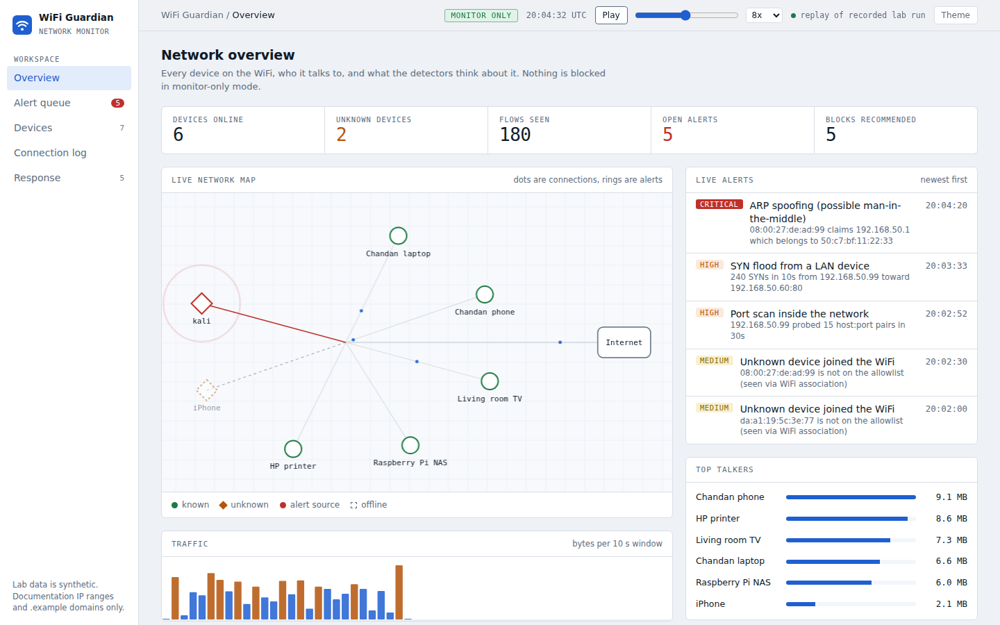

# WiFi Guardian

A WiFi network monitor for a home lab or small office, built the way an L1 SOC analyst would use it: see every device, catch suspicious behaviour, keep a forensic record of who connected and when, and (when you choose) block it.

It starts in **monitor-only mode**. Nothing is blocked until you switch it on.



[Watch the 90-second demo](media/wifi-guardian-demo.mp4) · [Test report](docs/TEST-REPORT.md)

## What it does

| Area | Details |
|---|---|
| Live visibility | Device register (MAC, vendor, randomized-MAC flag, hostname, IP history), flows, DNS lookups, top talkers, animated network map |
| Detections (13) | Unknown device, SYN/UDP/ICMP flood, port scan, ARP spoofing, rogue DHCP, WiFi deauth flood, C2 beaconing, DNS tunneling, large upload, blocklisted destination, risky outbound port |
| Forensic record | Every join/leave with MAC, IP, hostname, SSID/BSSID, signal; DNS and connection history per device; hash-chained audit log; evidence export with SHA-256 manifest |
| Response | Quarantine a MAC, rate-limit an IP, block a destination via nftables. Modes: `monitor` (default), `semi` (analyst approves), `auto`. Gateway and admin devices can never be blocked |
| Analyst workflow | Alert queue, MITRE ATT&CK tag, evidence, L1 next steps for every rule, alert status, CSV export |

Screens: [alert queue](docs/img/02-alert-queue.png), [devices](docs/img/03-devices.png), [connection log](docs/img/04-connection-log.png), [response](docs/img/05-response.png), [dark theme](docs/img/06-overview-dark.png).

## Try it in 30 seconds (no hardware, no network)

Needs Python 3.9 or newer. No packages to install for the demo.

```bash
git clone <your repo url> && cd wifi-guardian
python -m wifiguardian run          # runs the built-in lab scenario, prints the alert table
python -m wifiguardian log          # who connected when
python -m wifiguardian serve        # dashboard at http://127.0.0.1:8765 (replay of the scenario)
```
On Windows use `py -m wifiguardian ...` if `python` is not found. Optional: `pip install .` gives a `wifiguardian` command, `pip install ".[live]"` adds scapy for live capture, `pip install pytest && python -m pytest -q` runs the tests.

You can also open `wifiguardian/dashboard/index.html` directly in a browser: it replays a recorded run from `demo-data.js`.

The scenario is a VirtualBox-style lab: five known devices, one guest phone with a randomized MAC, and a Kali VM that scans, floods, ARP-spoofs, runs a rogue DHCP server and deauths a phone, while a compromised Raspberry Pi beacons, tunnels DNS and uploads 80 MB. All addresses are private or RFC 5737 documentation ranges.

## Forensics

```bash
python -m wifiguardian log                                   # who joined/left, MAC, IP, hostname, vendor
python -m wifiguardian run --db wg.db                        # keep the record in SQLite
python -m wifiguardian verify --db wg.db                     # audit hash chain check
python -m wifiguardian export-case --out case-001 --mac 08:00:27:de:ad:99
```
`export-case` writes `connection_log.csv`, the device timeline (JSON), the audit chain and a `MANIFEST.json` with the SHA-256 of every file, so you can show later that the evidence was not edited.

The audit chain stores, for every alert, action and first-seen device, the hash of the previous entry. Editing or deleting a row breaks every hash after it (covered by tests). It proves tampering *after the fact*; it does not stop someone with root on the box from rewriting the whole chain, so copy the chain head somewhere else if it matters.

## Response modes

| Mode | Behaviour |
|---|---|
| `monitor` | Records what it would do. Changes nothing. |
| `semi` | Marks actions as pending. Click **Approve** in the dashboard's Response page (when served with `serve`) to release one. |
| `auto` | Generates the nftables commands. Executes them only with `--apply` on a Linux gateway as root. |

```bash
python -m wifiguardian nft-ruleset      # base ruleset to load on the gateway
```
In semi/auto mode an unknown device goes to a quarantine set (DNS/DHCP only, no internet) until you approve it. In monitor mode it is only flagged.

## Honest limits

- **HTTPS content is not visible.** You see device, destination, port, DNS name and TLS site name, not page content.
- **To see and block traffic the box must be the gateway** (or get mirrored traffic). A laptop that just joins the WiFi sees only its own traffic.
- **It cannot stop internet-side DDoS** that fills your ISP link. It stops floods from devices inside the WiFi and rate-limits abusive sources.
- **Deauth detection needs a WiFi adapter in monitor mode.** On a VirtualBox lab you need a USB adapter passed through to the VM.
- **Tested:** all detectors, the forensic store, enforcement command generation and the dashboard (39 tests on Python 3.9 to 3.13, plus browser checks on the simulated scenario, see [docs/TEST-REPORT.md](docs/TEST-REPORT.md)). **Not yet tested on live hardware:** the scapy sniffer, the dnsmasq lease watcher against a real gateway, and the generated nftables rules. Treat `auto --apply` as experimental and try it in a VM first.
- The OUI vendor table is a small demo subset. Pass an IEEE OUI file for full coverage.

## Layout

```
wifiguardian/   engine, event validation, detectors, rules (MITRE + L1 playbooks), forensics, enforcement, simulator, server, capture
wifiguardian/dashboard/   single-page dashboard (no build step)
tests/          detectors, forensics, enforcement
config/         example.json
docs/           LAB.md (VirtualBox setup), DESIGN.md (original proposal), screenshots
```
Detections are explainable rules, not a black box: thresholds live in `config.py` and every alert shows the evidence that triggered it. The beaconing and DNS-tunnel logic follows the same approach as my `soc-triage-console` network analyzer, here running on a live stream.

## Event format (to feed your own data)

One JSON object per line, passed with `--events file.jsonl`:

```json
{"type":"assoc","ts":1791057601,"mac":"aa:bb:cc:00:00:01","action":"join","bssid":"..","ssid":"..","rssi":-50}
{"type":"dhcp","ts":1791057602,"mac":"aa:bb:cc:00:00:01","ip":"192.168.50.20","hostname":"laptop","action":"lease"}
{"type":"flow","ts":1791057610,"src_ip":"192.168.50.20","dst_ip":"203.0.113.9","dport":443,"proto":"tcp","bytes":1200,"syns":1,"sni":"x.example"}
{"type":"dns","ts":1791057611,"src_ip":"192.168.50.20","query":"x.example","qtype":"A"}
{"type":"arp","ts":1791057620,"op":"reply","src_mac":"..","src_ip":"..","dst_ip":".."}
{"type":"dhcp_offer","ts":1791057630,"server_mac":"..","server_ip":".."}
{"type":"deauth","ts":1791057640,"src_mac":"..","dst_mac":"..","count":12}
```

## Security notes
- The dashboard server listens on `127.0.0.1` only by default and has no login. If you bind it to another address it prints a warning; only do that on a network you trust.
- Approve buttons use POST requests that need a custom header and a same-origin request, so a web page open in your browser cannot trigger them.
- Hostnames and DNS names come from devices on your network and are untrusted. They are escaped in the dashboard, neutralized in CSV exports, and stored with parameterized SQL.
- Malformed events are rejected with a reason (never a crash) and counted; `run` prints how many were skipped.
- SQLite needs version 3.24 or newer (any Python 3.9+ build qualifies).

## Use only on networks you own or are allowed to test.
